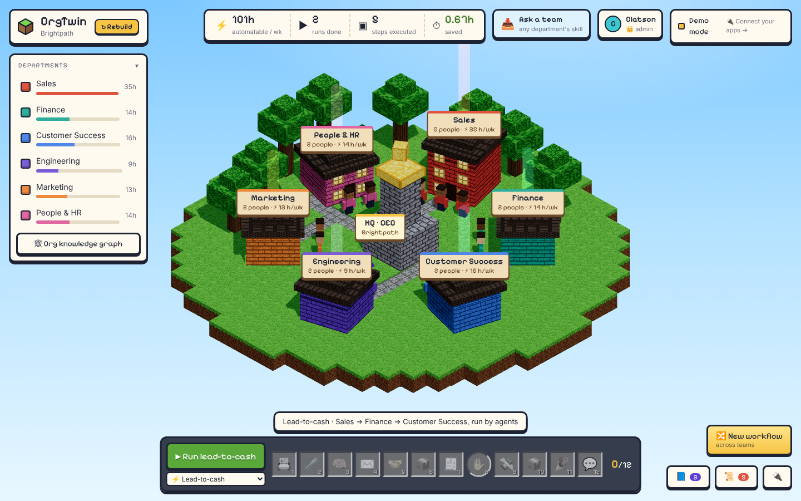
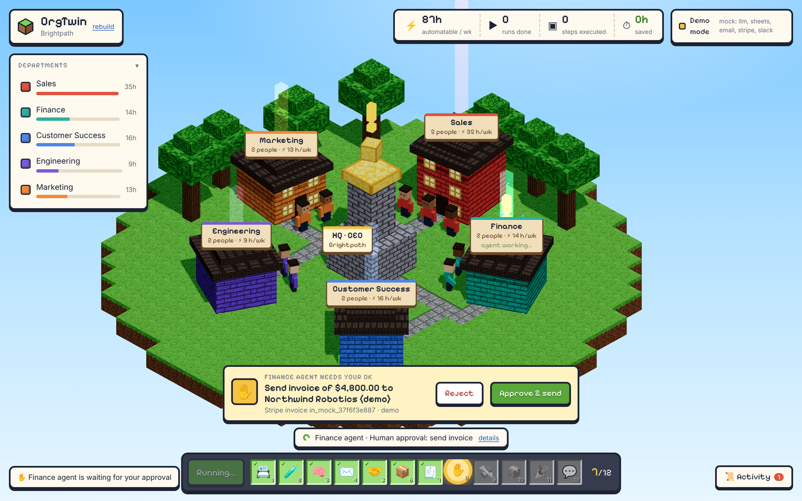
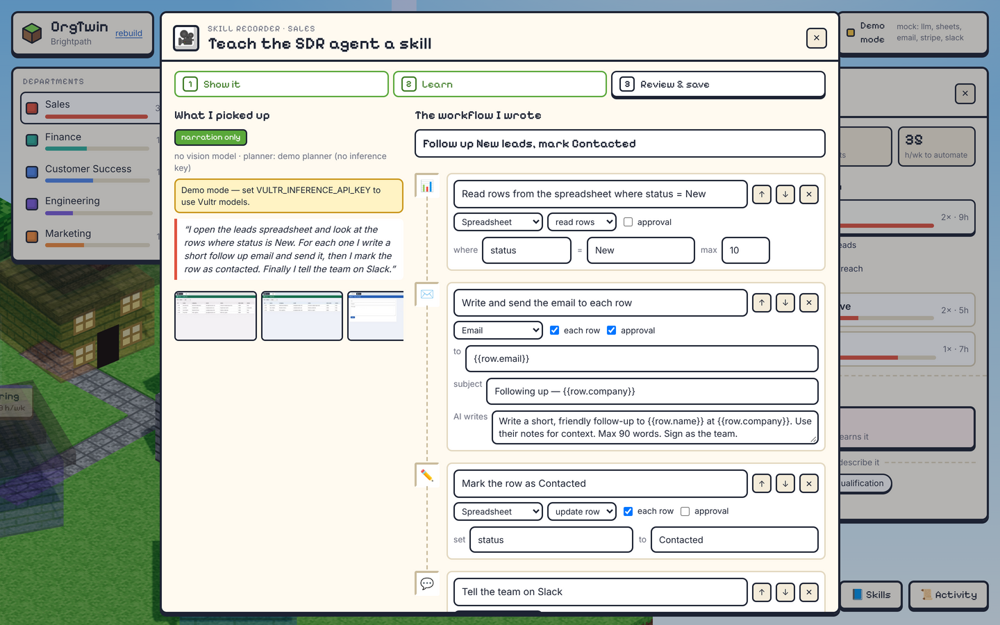

# OrgTwin — a live 3D operations twin of your company, run by AI agents on Vultr

> Vultr: Agent Rush Hackathon · Challenge 02 · **Powering the Future of Work**

Describe your company (or upload an org CSV) and OrgTwin builds it as a **block-world island** in an
isometric view: every team is a building, every role is a worker agent standing outside it, and each
building's beacon shows how many hours per week AI could take off people's plates. Click a team to fly into it, pick a role, and have the agent design a
workflow in plain language, or record yourself doing the task once.

Then the whole company uses those skills. An admin invites each team and ticks the departments they look after.
Each team teaches its agents its own skills, with tools (GitHub, Notion, MCP servers…) when needed. Anyone can
**📥 ask a team** for work, e.g. a sales person writes *"I need an analysis of Q3 churn"*. OrgTwin runs the IT
team's skill, returns the answer, and pings the IT people on Slack / Discord.





One workflow runs **for real, end to end, across three departments: lead-to-cash.**

```
Sales agent ──A2A──▶ Finance agent ──(human approval)──▶ Customer Success agent
 pick lead from CRM     draft Stripe invoice     ✋ approve     finalize + email invoice
 score it in sandbox                                            hand off (A2A)
 qualify + draft email                                          personalised onboarding email
 send email, update CRM                                         Slack summary · hours saved
```

In the world you watch it happen: the active team's workers get busy and its windows light up, each
handoff travels the stone paths as a crate, a pending approval floats a "!" over HQ and Finance, and a
game-style hotbar at the bottom fills in as each of the 12 steps completes.

## Cross-team workflows: describe it, every department's agent does its part

Click **🔀 New workflow** (bottom right). A panel slides in from the left: describe the task in plain
language, e.g. *“Sales reads the Won deals, Finance invoices each one after approval, then Customer Success
sends a welcome email”*, and press **✦ Design with AI**. The model splits it into steps, gives each step to
a department's agent and puts an A2A **handoff** wherever the work moves to another team (if it forgets
one, OrgTwin adds it). Six sample workflows are one click away, and **✨ Ideas for <company>** asks the
model for workflows that fit your own departments.

Run it from the panel or the bottom bar (pick any workflow there). In the world, each team's building
lights up when its agent works and every handoff travels the paths as a crate. Every step can be edited,
including which team does it; handoffs are kept consistent when you change a step's team. Steps can also
**search the web** (`web/search`, `web/read_page`) and later AI steps use the results.

## People, requests and skill tools

```
Sales (Sam) ── "I need an analysis of …" ──▶ OrgTwin picks the best skill in any department
                                              ▼
                                   IT skill runs (its granted tools: GitHub, MCP, web…)
                                              ▼
                     result → Sam in the app · 💬 Slack / 🎮 Discord → IT's people (@mentioned)
```

- **👑 Admin + departments.** The first person becomes admin and invites the rest with a personal link,
  ticking the departments each person looks after (green ticks). People create and edit skills only in their
  own departments. Everyone can see and run every skill.
- **📥 Ask a team** (top bar). A sales person writes *"I need an analysis of …"*. OrgTwin finds the skill that can
  do it in any department (the AI chooses, with a keyword fallback; or you pick it). It runs the skill with the
  request as input (`{{request}}`) and pings that department's people on Slack / Discord with the result. Each
  person picks the channel and can be @mentioned. If no skill fits, the likely department is asked to record one.
- **🧰 Skill tools.** Give a skill access to apps (GitHub, Notion, …) and **MCP servers**, or single MCP tools.
  Its steps can only use what is ticked. The *AI agent with tools* step calls those tools by itself until the job
  is done, and asks the owning department to approve anything that sends or changes something.
- **🐙 GitHub, working on PRs.** List PRs, read a PR's description and changed code for an AI review, post the
  review (comment or request changes; an agent never approves), comment, open issues, and open a PR that
  changes one file. Typical skill: `github/read_pr` → `llm/write` ("review {{pr}}") → `github/review_pr`.
- **🗺 Quests.** A 9-step setup checklist in 👥 People that ticks itself green as you go.

| | Admin | Member |
|---|---|---|
| See and run every skill, send requests | ✓ | ✓ |
| Create / edit skills, give them tools, approve steps | every department | ticked departments only |
| Build the company, connect apps, add MCP servers, invite people | ✓ | – |

Details: [docs/people.md](docs/people.md) and [docs/connectors.md](docs/connectors.md).

## Skill Recorder: show it once, the agent learns it



Writing workflows is the slow part of any agent platform. In OrgTwin you **do the task once** instead:

1. **Show it.** Click a worker → *Record a skill*. Record your screen (any window or tab) while talking
   through what you do, or upload a screen recording you already have. Narration is transcribed live
   in the browser (Web Speech API), or you can type it.
2. **Learn.** Keyframes are pulled out of the video *in the browser*. A new frame is kept only when the
   screen really changed, plus one at least every 6 s. Up to 24 keyframes and the narration go to
   **Vultr Serverless Inference**: a vision model describes what happens in each frame (app, sheet,
   columns, filters, recipient), then an LLM turns observations + narration into an **executable**
   workflow. The raw video never leaves the browser; frames are not stored, only the text observations.
3. **Review & save.** You see what it picked up and the steps it wrote, edit anything, and save it as a
   skill on that role. The worker in the world now carries a book; the org-wide **Skill library** lists
   every skill by department.
4. **Run.** The agent runs the skill on live data: e.g. read every `status = New` row, write and send
   each person an email, mark the row `Contacted`, post a Slack summary. One approval card covers the
   whole batch and lists every recipient before anything is sent.

Step library the engine can run today: read sheet rows (with a filter), update a row, AI write, send
email (body written by the AI), human approval, Slack post, hand off to another team, and the **AI agent with
tools** step. Plus the connectors **GitHub, Discord, Microsoft Teams, Telegram, Notion, HubSpot, Stripe
invoices, web search and generic webhooks** (see [docs/connectors.md](docs/connectors.md)). Templates like `{{row.email}}` and
`{{row.company}}` fill in each row. Workflows designed from a text description use the same format, so
they run too.

Try it without accounts: `sample-data/practice-desk.html` is a tiny spreadsheet + mail page to record
yourself on, and `sample-data/skill-demo.webm` is a ready-made 24 s recording to upload.

What it is and isn't: it learns **from a demonstration into an editable workflow**; it does not train
or fine-tune a model. When no vision model is available on the account it says so and learns from the
narration only.

## How Vultr powers it

| Vultr service | What it does in OrgTwin |
|---|---|
| **Cloud Compute VM** | Hosts the whole platform: Caddy (HTTPS), the Next.js web app, the FastAPI orchestrator + agent runtime, and Postgres, via Docker Compose. It is the control plane, not static hosting. |
| **Serverless Inference** (`https://api.vultrinference.com/v1`, OpenAI-compatible) | All agent reasoning: building the org from a description/website/CSV, designing workflows, qualifying leads and drafting outreach, writing emails. For the Skill Recorder, a vision model reads the recorded keyframes and an LLM writes the workflow. |
| **Isolated execution on the VM** | Lead scoring runs in a throwaway Docker container per run: `--network none`, read-only filesystem, 128 MB memory, 0.5 CPU, 64 PIDs, all capabilities dropped, non-root user, no secrets, killed after 20 s, destroyed after every run. |

No Vultr GPUs are used (they aren't available for this event).

## Architecture

```
Browser (3D: React Three Fiber)
   │  HTTPS
   ▼
Caddy ── /api/* ─▶ FastAPI orchestrator ──▶ Vultr Serverless Inference
   │                 │  ├─ workflow engine, A2A handoffs, approvals, AI agent tool loop
   │                 │  ├─ people & departments (who may edit what), requests + Slack/Discord notices
   │                 │  ├─ connectors: Sheets · Gmail/SMTP · Stripe (test) · Slack · Discord · Teams ·
   │                 │  │              Telegram · Notion · HubSpot · GitHub · web search · webhooks
   │                 │  ├─ sign-in popups (OAuth) for connecting apps · MCP client (Streamable HTTP)
   │                 │  ├─ sandbox runner ─▶ docker run --network none … (per run)
   │                 │  └─ audit log + live events (SSE)
   │                 ▼
   └── / ─▶ Next.js  Postgres (orgs, workflows, runs, approvals, people, requests, settings, audit log)
```

- **Agents & A2A:** each team has an agent (`GET /api/agents` returns its agent card and skills). Handoffs
  between departments are A2A-style task messages (`kind: task`, `from`/`to`, text + data parts), stored
  in the audit log and animated in 3D.
- **Human in the loop:** sending money-related messages needs a person's approval (in the app; a Slack
  notification links to it). Rejecting stops the run and marks the CRM row.
- **Who may change what:** once an admin exists, every change needs a signed-in person (personal invite
  link; only its SHA-256 is stored). Members change skills only in their departments; connecting apps, MCP
  servers and inviting people are admin-only. Connector secrets are stored server-side and never sent back
  to the browser.
- **Safety for a public demo:** Stripe accepts **test keys only**. `EMAIL_REDIRECT_TO` sends every email
  to one inbox you control. `APP_ACCESS_TOKEN` locks every change before an admin exists, and afterwards
  works as an admin key for scripts. An agent never approves a GitHub PR. MCP servers on private addresses are
  refused unless `MCP_ALLOW_PRIVATE=true`.
- **Demo mode:** any missing credential falls back to a mock, and the top bar says which. That lets the
  app run with zero keys; with keys it does the real thing.

## Run locally

```bash
# API
cd api && python -m venv .venv && . .venv/bin/activate && pip install -r requirements.txt
RUNNER=local uvicorn app.main:app --port 8000      # RUNNER=docker for the isolated sandbox
# Web
cd web && npm install && NEXT_PUBLIC_API_BASE=http://localhost:8000 npm run dev
```
Tests: `cd api && pytest -q`. They cover:
- the end-to-end lead-to-cash run in demo mode, approval / rejection and CSV import
- sandbox containment: no network, read-only, no secrets, a timeout kills the container
- sign-in popups for every connector, with faked provider replies
- people and departments, a Sales → IT request with Slack / Discord notices, MCP tools, and GitHub

First run: open the app → 👥 **Set up admin** → invite your team. The 🗺 Quests checklist walks through the
rest. [`pending.md`](pending.md) lists the one-time registrations for the Connect popups.

## Deploy on Vultr

1. **Credits:** claim the $200 hackathon credits (Billing → gift code).
2. **Inference:** Console → Products → Serverless → Inference → *Add Serverless Inference*. Copy the
   subscription's API key (not the account API key).
3. **VM:** deploy a Cloud Compute instance (Ubuntu 24.04, 2 vCPU / 4 GB is enough). Optionally point a
   domain's A record at its IP.
4. **Bootstrap:** SSH in as root and run:
   ```bash
   git clone https://github.com/clatsonhacks/Orgtwin.git /opt/orgtwin
   bash /opt/orgtwin/deploy/vultr-bootstrap.sh   # creates .env on first run
   nano /opt/orgtwin/.env                        # add keys (see below)
   bash /opt/orgtwin/deploy/vultr-bootstrap.sh   # builds and starts everything
   ```
5. Open `http://<VM IP>`, or `https://<your domain>` with `SITE_ADDRESS=<your domain>`.

### Keys (`.env`, never committed)

Users connect Google Sheets, Gmail, Stripe, Notion, Slack, Discord, HubSpot and GitHub from the app (**🔌 Connectors →
Connect**, then sign in and click Allow), and Telegram by pressing Start on OrgTwin's bot. To turn on those
popups, the admin registers OrgTwin once with each service (`GOOGLE_OAUTH_*`, `STRIPE_CONNECT_*`,
`NOTION_OAUTH_*`, `SLACK_CLIENT_*`, `DISCORD_CLIENT_*`, `HUBSPOT_CLIENT_*`, `GITHUB_CLIENT_*`, `TELEGRAM_BOT_TOKEN`). The steps are in
[docs/connectors.md](docs/connectors.md#one-click-sign-in-the-admins-one-time-setup). Teams, webhooks and web search open a
short form in the app. Everything in the table below can still be set in `.env` instead.

| Variable | Where to get it |
|---|---|
| `VULTR_INFERENCE_API_KEY` (+ optional `VULTR_INFERENCE_MODEL`) | Serverless Inference subscription |
| `GOOGLE_SERVICE_ACCOUNT_JSON`, `GOOGLE_SHEET_ID` | Google Cloud service account JSON → put it in `secrets/google-sa.json`. Import `sample-data/leads.csv` into a sheet and share it with the service account's email. |
| `SMTP_*`, `EMAIL_REDIRECT_TO` | e.g. Gmail: `smtp.gmail.com`, port 587, an app password |
| `STRIPE_SECRET_KEY` | Stripe dashboard → test mode → `sk_test_…` |
| `SLACK_WEBHOOK_URL` | Slack app → Incoming Webhooks |
| `DISCORD_WEBHOOK_URL`, `TEAMS_WEBHOOK_URL`, `TELEGRAM_*`, `NOTION_*`, `HUBSPOT_TOKEN`, `WEBHOOK_*` | Optional connectors — see [docs/connectors.md](docs/connectors.md). Each stays in demo mode until set. |
| `GITHUB_TOKEN`, `GITHUB_REPO` | Optional, instead of signing in with GitHub: a fine-grained token (Pull requests, Issues, Contents) and the default `owner/name` |
| `MCP_ALLOW_PRIVATE` | `true` only to use an MCP server on your own machine / LAN (MCP servers themselves are added in the app) |
| `APP_ACCESS_TOKEN`, `PUBLIC_APP_URL`, `PUBLIC_API_URL` | Access code for the first admin / scripts; the app's public URL (invite links); where the browser reaches the API (OAuth redirects) |
| `TAVILY_API_KEY` or `BRAVE_SEARCH_API_KEY` | Optional: full web results for the web search step (it works without a key, with fewer results) |
| `VULTR_VISION_MODEL`, `VULTR_REASONING_EFFORT` | Vision model for the recorder (e.g. `mimo-v2.6-pro`); `none` turns model thinking off so replies aren't empty |

## Known limits (honest list)

- Recorded and designed workflows run when they only use the step library and connectors above;
  sandbox-code steps can be designed but not run yet.
- One run at a time (the world shows one): requests wait their turn. MCP servers must be reachable over
  HTTP (Streamable HTTP); local stdio servers are not supported. The agent tool loop relies on the model
  answering in JSON. It was tested with a stand-in model, not yet with every Vultr model.
- People sign in with their invite link (no passwords or SSO). Treat the link like a password.
- Live screen recording needs a desktop browser with screen sharing (Chrome, Edge, Firefox); live
  transcription needs Chrome or Edge. Elsewhere you can upload a video and type the narration.
- Vision model availability on Vultr Serverless Inference is not confirmed yet; without one the
  recorder learns from the narration only (and says so).
- "Deal won" is simulated in the demo (in production it waits for the buyer's reply or signed order).
- The API container uses the host Docker socket to start sandbox containers, which gives it host-level
  power. Fine for a single-tenant demo VM; a production setup would put a socket proxy or a separate
  runner VM in between.
- Approvals happen in the app; Slack and Discord only notify.

## Docs

Plans, architecture, decisions and the demo script live in [`docs/`](docs/README.md).

## Licence

MIT
