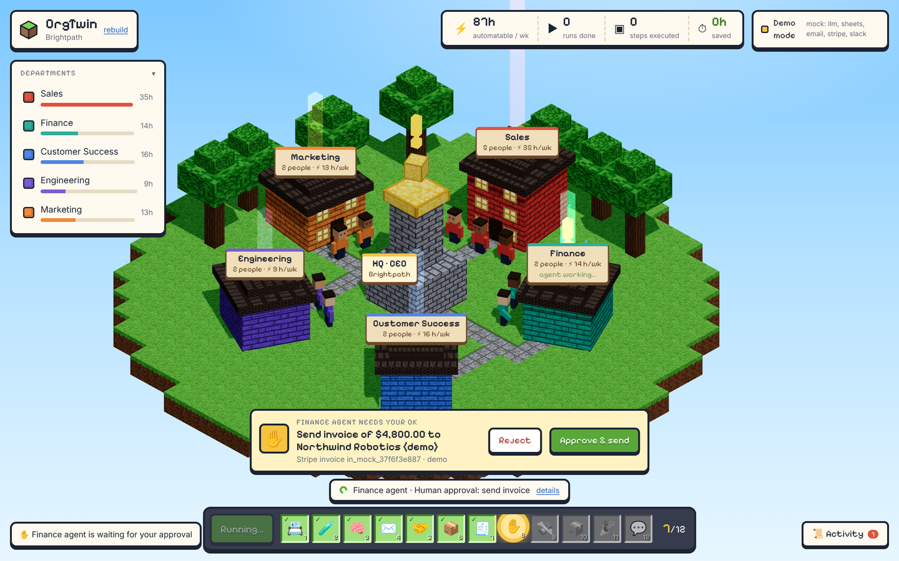
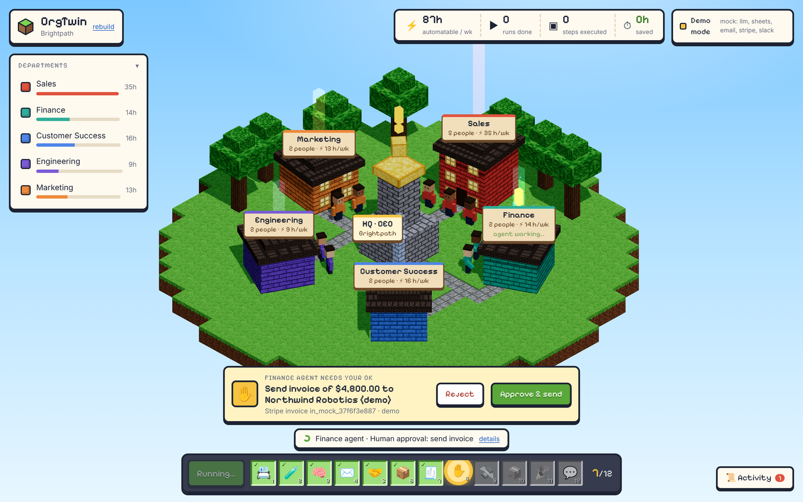

# Hero workflow: lead-to-cash

One workflow runs for real, end to end, across three departments (see
[ADR 0002](decisions/0002-hero-workflow-lead-to-cash.md)). Defined in `api/app/engine.py` (`HERO_STEPS`).

| # | Team | Step | Tool | Manual minutes saved |
|---|---|---|---|---|
| 1 | Sales | Pick next new lead from CRM | Sheets | 3 |
| 2 | Sales | Score lead in isolated sandbox | Sandbox | 10 |
| 3 | Sales | Research & qualify, draft outreach | LLM | 20 |
| 4 | Sales | Send outreach email, update CRM | Email | 5 |
| 5 | Sales | Deal marked won | Sheets | 2 |
| 6 | Sales → Finance | Hand off to Finance agent | A2A | 10 |
| 7 | Finance | Create draft invoice | Stripe (test) | 10 |
| 8 | Finance | **Human approval: send invoice** | Approval | 0 |
| 9 | Finance | Finalize & email invoice | Email | 8 |
| 10 | Finance → Customer Success | Hand off to Customer Success agent | A2A | 10 |
| 11 | Customer Success | Send personalised onboarding email | Email | 20 |
| 12 | Customer Success | Post summary to team channel | Slack | 5 |

Total: 103 manual minutes per run.

## In the world
The active team's workers get busy and its windows light up; each handoff travels the stone paths as a
crate; a pending approval floats a "!" over HQ and Finance; the hotbar fills in as each of the 12 steps
completes.

## Behaviour notes
- Rejecting the approval stops the run and marks the CRM row.
- Only one lead-to-cash run can be active at a time (`409` otherwise).
- "Deal won" is simulated in the demo; in production it would wait for the buyer's reply or signed order.
- Other workflows (hire-to-onboard, ticket-to-resolution) can be designed from text, and run if they only
  use the step library ([skill-recorder.md](skill-recorder.md#step-library)).
