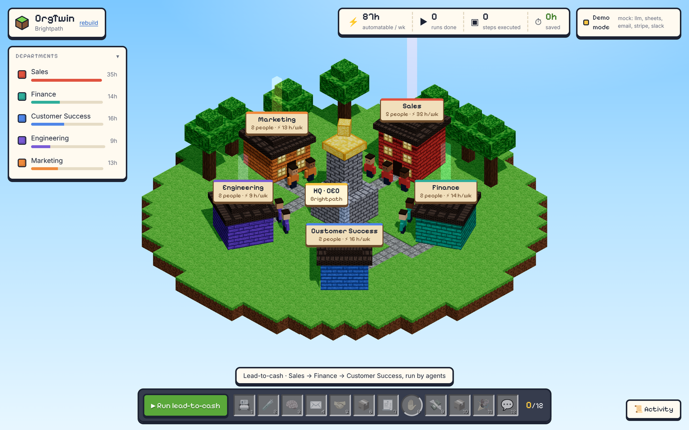
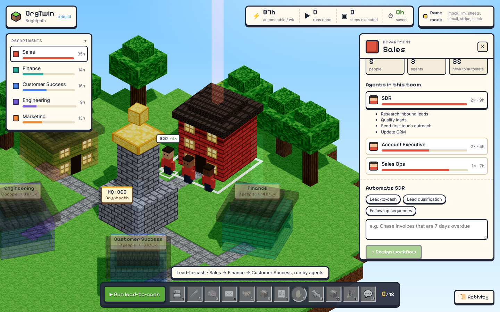
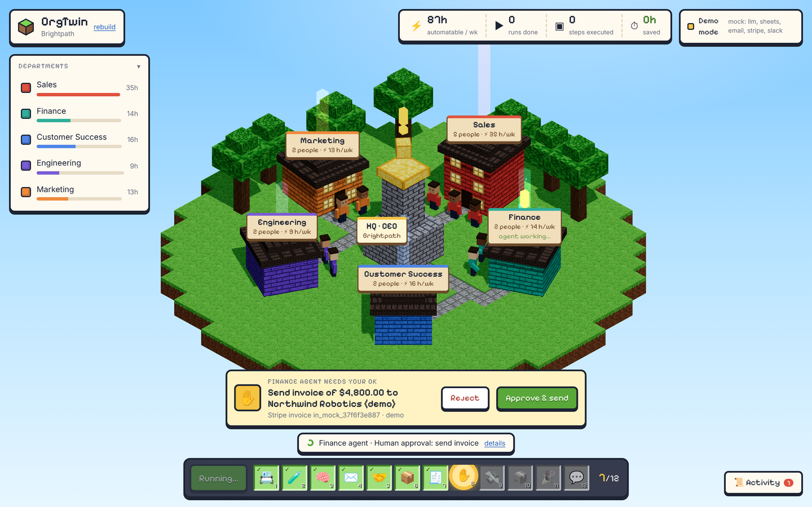

# Overview

## One-liner
OrgTwin is a living twin of your company where every role has an AI agent, and your best people teach
those agents by doing the task once on screen.

## Problem
Every team has hours of repetitive work: chasing leads, sending invoices, onboarding emails. Agent
builders exist, but someone still has to *describe* every workflow, so most of that work never gets
automated and the know-how stays in people's heads. Teams also don't know *where* AI would help most.

## Solution
1. **Build the twin.** Describe the company, give a website, or upload an org CSV. OrgTwin builds it as
   an isometric block world: departments are buildings, roles are worker agents, and each building's
   beacon shows how many hours per week AI could take over (the automation-opportunity heatmap).
2. **Teach by showing (Skill Recorder).** Record your screen once while talking through a task. OrgTwin
   turns the recording and narration into an editable, executable workflow and saves it as a skill on
   that role.
3. **Agents do the work, people approve it.** The role's agent runs the skill on live data. Anything
   that leaves the company waits for one human approval. Departments hand work to each other
   agent-to-agent (A2A).
4. **See the work.** Workers get busy, handoffs travel between buildings as crates, approvals float a
   "!" over the building, and a hotbar tracks every step and hours saved.

## Design principles
- **3D carries information**, not decoration: live operations, handoffs, bottlenecks, approvals.
  Editing happens in 2D panels.
- **Depth over breadth**: one cross-team workflow (lead-to-cash) runs for real, end to end, instead of a
  generic builder with many half-working connectors.
- **Trust by default**: per-run sandboxing, human approval before anything external, audit log, test-only
  payments, email redirect for demos.
- **Works with zero keys**: every missing credential falls back to a mock and the UI says so.

## Positioning
The market for AI workforce and agent builders is crowded (Lindy, Relevance AI, n8n, Copilot Studio,
Agentforce). Task-capture tools exist too (Scribe, Tango, UiPath Task Capture, Power Automate task
mining). OrgTwin's difference is the combination:
- an **org-shaped** twin with an opportunity map ("where should we use AI?"),
- **cross-team handoffs** between department agents,
- an **org-level skill library** learned from demonstrations and run by agents with approvals.

## Screens

