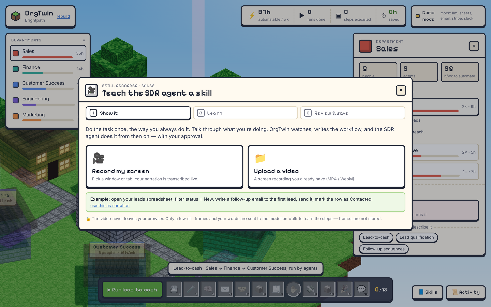
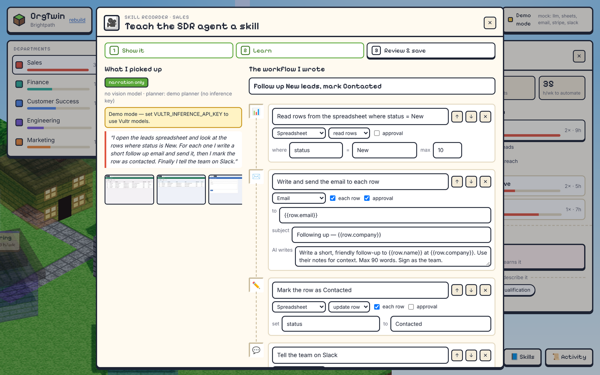
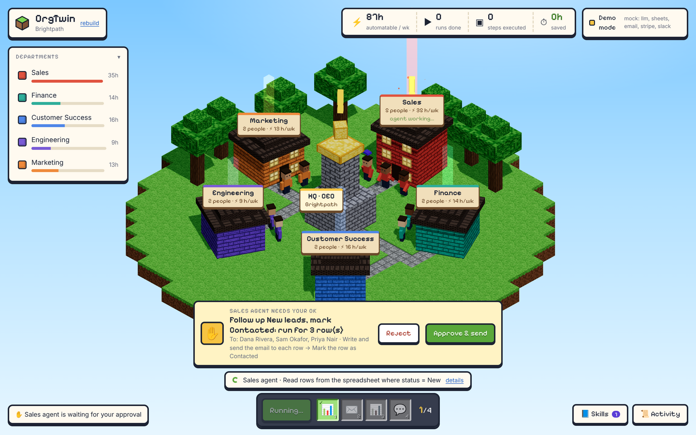

# Skill Recorder

Show OrgTwin a task once; it writes the workflow; a person reviews it; the role's agent runs it.
Decision: [ADR 0005](decisions/0005-skill-recorder.md).

## Flow
1. **Show it.** Click a worker → *Record a skill*. Record the screen (any window or tab) while talking
   through the task, or upload an existing recording. Narration is transcribed live in the browser
   (Web Speech API) or typed.
2. **Learn.** Keyframes are extracted *in the browser* (`web/lib/capture.ts`): a frame is kept only when
   the screen really changed, plus one at least every 6 s, up to 24. Keyframes and narration go to the
   API; the server samples up to 16 for the vision model (`api/app/skills.py`), which describes each frame
   (app, sheet, columns, filters, recipient). An LLM then turns observations + narration into an
   executable workflow.
3. **Review & save.** The person sees what was picked up and the steps written, edits anything, and saves
   it as a skill on that role. The worker carries a book; the org-wide skill library lists every skill by
   department.
4. **Run.** The agent runs the skill on live data. One approval card covers the whole batch and lists
   every recipient before anything is sent.

## Step library
What the generic engine can execute today:

| Step | What it does |
|---|---|
| Read sheet rows | With a filter, e.g. `status = New` |
| For each row | Per-row loop |
| AI write | LLM writes text for the row |
| Send email | Body written by the AI |
| Update row | e.g. set `status = Contacted` |
| Human approval | One approval for the batch |
| Slack post | Summary to the team channel |

Templates such as `{{row.email}}` and `{{row.company}}` are filled per row. Workflows designed from a text
description use the same schema, so they are runnable too.

## Fallbacks
- No vision model on the account → learn from narration only, and say so.
- No inference key → deterministic planner. The result always states which path ran.

## Privacy
The raw video never leaves the browser. Keyframes are processed in memory and never stored; only the text
observations and transcript are kept (in the workflow's `meta`).

## Try it without accounts
- `sample-data/practice-desk.html`: a tiny spreadsheet + mail page to record yourself on.
- `sample-data/skill-demo.webm`: a ready-made 24 s recording to upload.

## Wording
Say "learns from a demonstration into an editable workflow". Never "trains a model".

## Limits
- Live screen recording needs a desktop browser with screen sharing (Chrome, Edge, Firefox); live
  transcription needs Chrome or Edge. Elsewhere, upload a video and type the narration.
- Steps outside the library (MCP, HTTP, …) can be designed but not run yet.
